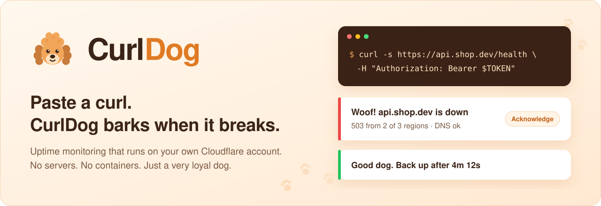
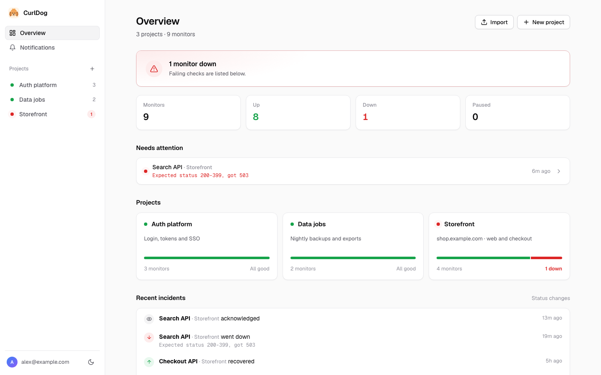
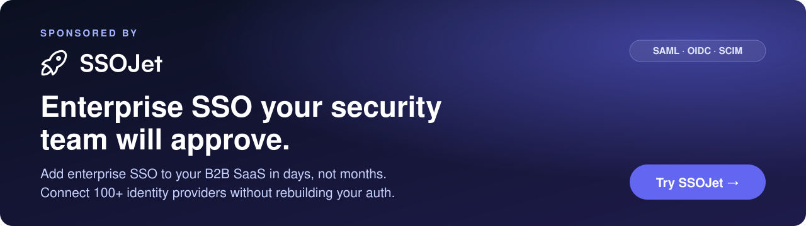
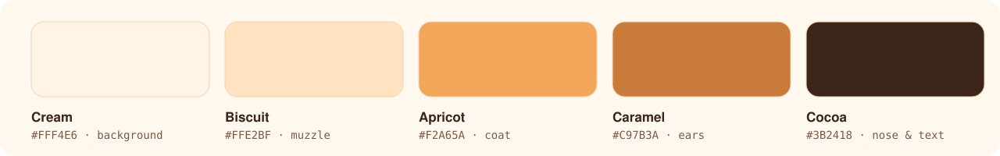
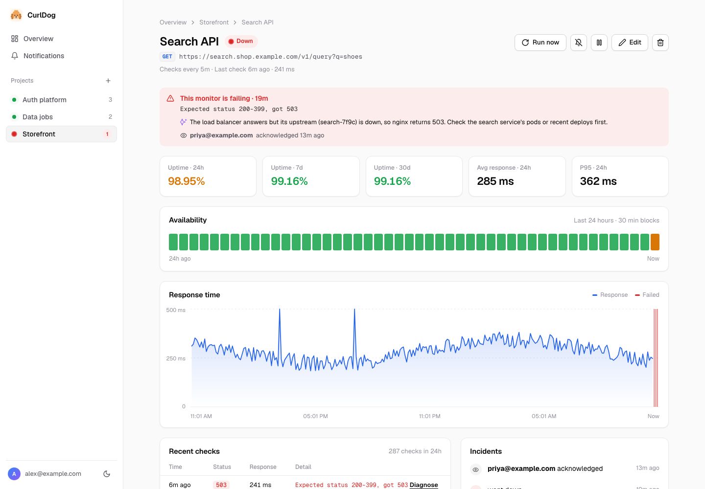
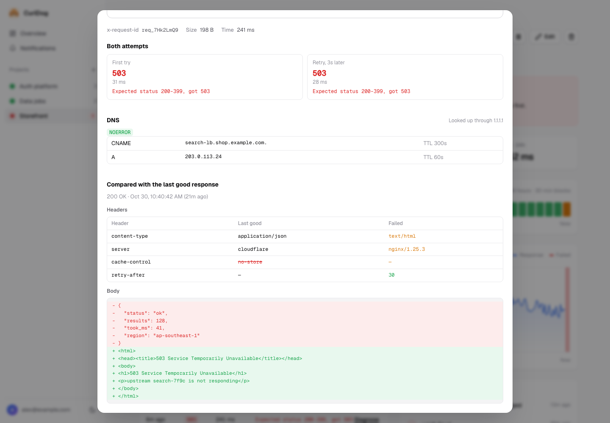
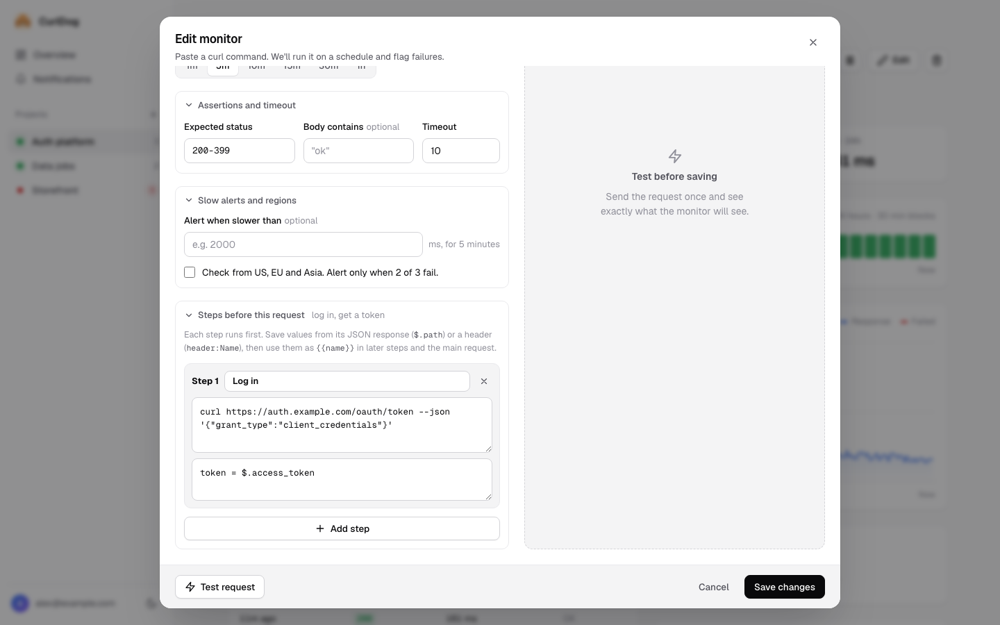
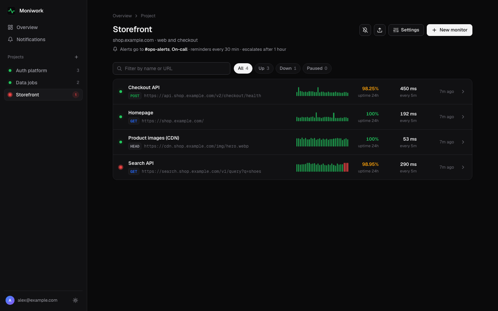
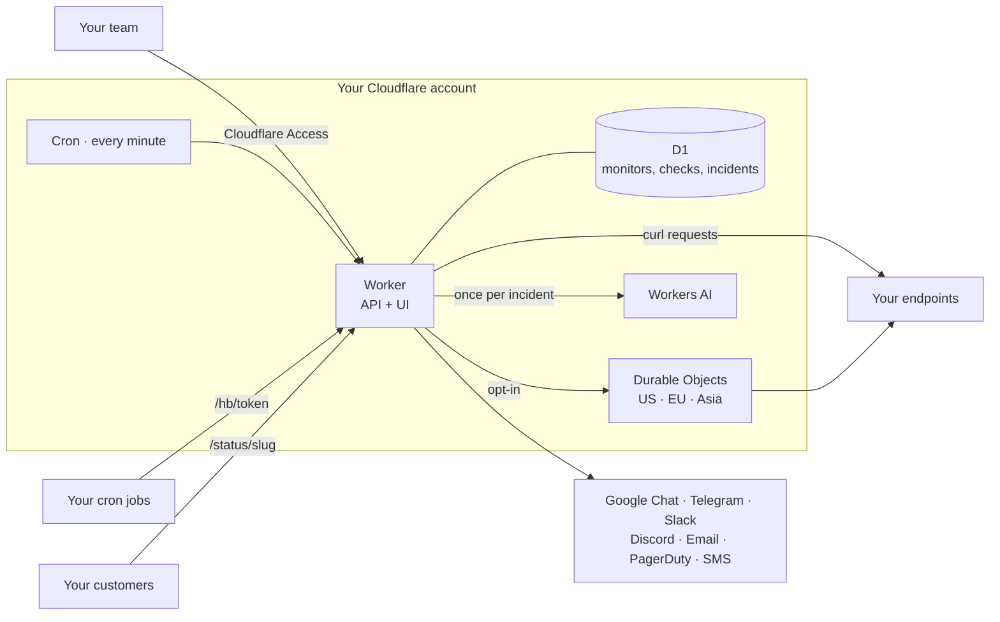

<div align="center">



<h1>CurlDog</h1>

**Paste a curl. CurlDog barks when it breaks, and tells you why.**

Self-hosted uptime monitoring for teams, running entirely on your own Cloudflare account.<br>
No servers, no containers, no database to babysit. Just a very loyal dog.

[](https://deploy.workers.cloudflare.com/?url=https://github.com/Compile7/curldog)

[](https://github.com/Compile7/curldog/actions/workflows/ci.yml)
[](LICENSE)
[](CONTRIBUTING.md)


<sub>Sponsored by <a href="https://ssojet.com/?utm_source=github&utm_medium=readme&utm_campaign=curldog&utm_content=header"><b>SSOJet</b></a>: enterprise SSO for B2B SaaS</sub>

[Deploy](#-deploy-in-5-minutes) · [Features](#-features) · [How it works](#-how-it-works) · [Local dev](#-local-development) · [Contributing](CONTRIBUTING.md)

<br>



<br><br>

<a href="https://ssojet.com/?utm_source=github&utm_medium=readme&utm_campaign=curldog&utm_content=banner"></a>

</div>

---

## Why CurlDog

Most uptime tools make you rebuild your request in their form. Then, when something fails, they tell you *that* it failed, but not *why*.

CurlDog starts from the request you already have:

1. **Copy as cURL** from your browser or terminal, and paste it in. Headers, auth, body and redirects all come along.
2. Pick how often to check it.
3. When it breaks, Google Chat or Telegram gets a message with the status, the response, **an AI explanation of the likely cause**, and buttons to **Acknowledge** or **Mute** it.

It all runs on your own Cloudflare account, behind your own login. Your API keys never leave infrastructure you control.

## 🐩 Meet Curly


Curly is an apricot poodle with one job: watch your endpoints and bark the moment one breaks.

- **Sniffs** every curl on schedule, from up to 3 regions.
- **Barks** in Google Chat, Telegram or Slack, with Acknowledge and Mute buttons.
- **Fetches** the evidence: DNS, the redirect chain, and a diff against the last good response.
- **Keeps barking** with reminders, and fetches a teammate if nobody comes.
- **Sits quietly** when you mute a monitor for planned work.



## ✨ Features

<table>
<tr>
<td width="50%" valign="top">

### Monitor anything you can curl
- Paste any curl, including Chrome's **Copy as cURL**. See what it parses into, then **Test it** before saving.
- Expected status (`2xx`, `200-299`, `200,204`), **body contains**, timeouts, redirects.
- **Multi-step checks:** log in, save `{{token}}` from the JSON response, call the real endpoint with it.
- **Heartbeats** for cron jobs and backups: they ping you, and you get alerted when they go quiet.
- **Check from 3 regions** (US, EU, Asia). It's only marked down when 2 of 3 agree.

</td>
<td width="50%" valign="top">

### Alerts people actually read
- **Google Chat** cards and **Telegram** messages with **Open · Acknowledge · Mute 1h** buttons. Slack, Discord, **email**, **PagerDuty** and **SMS** work too.
- Each alert includes the status, a body snippet, 7-day uptime, and an **AI summary of the likely cause** (Workers AI).
- One message per project when several monitors fail together, not a flood.
- **Reminders and escalation** until someone acknowledges.
- **Slow alerts** when responses stay over a threshold. **Scheduled maintenance** windows, or a quick **Mute** for deploys.

</td>
</tr>
<tr>
<td valign="top">

### Diagnose without SSH-ing anywhere
- The **first try and the 3-second retry**, side by side.
- **Redirect chain**, **DNS records** (via 1.1.1.1), request ID, response size.
- **Diff against the last good response**: which headers changed, and which body lines.

</td>
<td valign="top">

### Built for a team
- Projects group monitors. Notification channels are shared across projects.
- Uptime for 24h, 7d and 30d, response-time chart, incident timeline.
- **Weekly report** in your chat every Monday.
- **SSL certificate and domain expiry** warnings at 14 and 3 days.
- **Public status page** per project: uptime bars, incident updates you write, RSS feed, JSON and a badge.
- **Monitors as code**: pull, plan and apply a JSON file over the API.
- **Import from Uptime Kuma**, one project per site, notifications included.

</td>
</tr>
</table>

<table>
<tr>
<td width="50%"></td>
<td width="50%"></td>
</tr>
<tr>
<td align="center"><sub><b>An incident:</b> what failed, the likely cause, and who's on it</sub></td>
<td align="center"><sub><b>Diagnose:</b> both attempts, DNS, and a diff against the last good response</sub></td>
</tr>
<tr>
<td></td>
<td></td>
</tr>
<tr>
<td align="center"><sub><b>Multi-step checks:</b> log in, then reuse <code>{{token}}</code></sub></td>
<td align="center"><sub><b>Dark mode</b>, mobile layout, no framework</sub></td>
</tr>
</table>

## 🚀 Deploy in 5 minutes

### 1. Click the button

[](https://deploy.workers.cloudflare.com/?url=https://github.com/Compile7/curldog)

Cloudflare copies this repo to your GitHub account, creates the D1 database, applies the schema, and deploys. Every push to your copy redeploys it.

<details>
<summary><b>Prefer the command line?</b></summary>

```sh
git clone https://github.com/Compile7/curldog.git
cd curldog
npm install
npx wrangler login
npm run deploy
```

`npm run deploy` creates the database on first run, deploys the Worker, and applies migrations.
</details>

### 2. Lock it down with Cloudflare Access

Open your new Worker's URL. You'll see a setup page, because **CurlDog refuses every API request until Cloudflare Access protects it.** Nothing is exposed while you set it up.

1. In the Cloudflare dashboard: **Workers & Pages → curldog → Settings → Domains & Routes**. Next to your `workers.dev` URL, choose **Enable Cloudflare Access**. (On a custom domain, add a self-hosted Access application for it instead.)
2. **Manage Cloudflare Access →** edit the policy to allow your team, for example emails ending in `@yourcompany.com`.
3. From that Access application, copy the **Application Audience (AUD) tag** and your **team domain** (like `acme.cloudflareaccess.com`).
4. **Settings → Variables and Secrets → Add:**

   | Name | Value |
   |---|---|
   | `ACCESS_TEAM_DOMAIN` | `acme.cloudflareaccess.com` |
   | `ACCESS_AUD` | your AUD tag |
   | `APP_URL` *(optional)* | e.g. `https://status.acme.com`. Links in alerts use it. Without it, CurlDog uses the address you open it at. |

5. Reload. You'll sign in through Access and land on an empty dashboard.

> Variables you set in the dashboard survive later deploys (`keep_vars` is on).

### 3. Connect your chat

Go to **Notifications**, pick a channel, and click **Send test**.

| Channel | Setup |
|---|---|
| **Google Chat** | Space → **Apps & integrations → Webhooks** → add one, paste the URL. |
| **Telegram** | Message **@BotFather** → `/newbot` → paste the token. Add the bot to your group, send a message, click **Detect**. |
| **Slack / Discord** | Paste an incoming webhook URL. |
| **Email** | Create a [Resend](https://resend.com) API key and verify your sending domain. Free for 3,000 emails a month. |
| **PagerDuty** | Service → **Integrations** → **Events API V2** → paste the integration key. Down opens an incident, Acknowledge acknowledges it, and recovery resolves it. |
| **SMS** | Paste your Twilio Account SID, Auth Token and sender number. Only incidents are texted, not reports. |

### 4. (Optional) Open the public paths

Two paths are meant for people and servers that can't sign in to Access:

- **`/hb`** for heartbeat pings from your cron jobs. Each ping URL carries its own random token, and a ping can only say "I'm alive".
- **`/status`** for public status pages. They show the monitors you pick and the incidents you post, never URLs or errors.

For each one you use, add an Access application for that path on the same domain, with a **Bypass** policy for *Everyone*.

## 🧭 Using it

<details>
<summary><b>Public status page</b></summary>

In **Project settings**, tick **Public status page**, pick an address like `/status/acme`, and tick the monitors to show. To show a friendlier name ("Checkout" instead of "POST /v2/checkout"), edit the monitor and open **Status page**.

The page shows:

- an overall banner: operational, degraded (slow), partial or major outage, or maintenance,
- one line per monitor, with 30 days of daily uptime bars,
- incidents you posted, with every update,
- open and upcoming maintenance,
- outages the monitors caught on their own, from the last 14 days.

**Post an incident** with the megaphone button on the project: a title, minor or major impact, and a message. Add updates as you go (Investigating, Identified, Monitoring, Resolved). An open incident sets the banner, even if the monitors look fine.

Next to the page:

| URL | What it's for |
|---|---|
| `/status/acme/feed.atom` | RSS/Atom feed. Subscribe in a feed reader, or in Slack with `/feed subscribe`. |
| `/status/acme/status.json` | Current status, shaped like Atlassian Statuspage's `status.json`, so existing tools can read it. |
| `/status/acme/badge.svg` | A badge for your README: `` |

It never shows URLs, error messages, responses or who posted. Everything is cached for a minute.
</details>

<details>
<summary><b>Maintenance windows</b></summary>

On a project, click the **wrench** and schedule a window: once, every day, or every week. While it's open:

- the project's monitors aren't checked, so nothing alerts and no downtime is counted,
- the status page says "Scheduled maintenance in progress".

For a quick one-off, **Mute** still works too. Mute keeps checking but stops the messages.
</details>

<details>
<summary><b>API and monitors as code</b></summary>

Everything the UI does goes through a JSON API under `/api`. Scripts sign in with a **Cloudflare Access service token**:

1. Zero Trust → **Access → Service credentials** → create a service token.
2. In CurlDog's Access application, add a policy with action **Service Auth** that includes that token.
3. Send `CF-Access-Client-Id` and `CF-Access-Client-Secret` headers with each request.

`scripts/curldog.mjs` keeps your monitors in a JSON file you can review in pull requests:

```sh
export CURLDOG_URL=https://curldog.acme.workers.dev CF_ACCESS_CLIENT_ID=… CF_ACCESS_CLIENT_SECRET=…
node scripts/curldog.mjs pull > curldog.json   # export what's live
node scripts/curldog.mjs plan curldog.json     # show what would change
node scripts/curldog.mjs apply curldog.json    # create and update; add --prune to delete monitors not in the file
```

- Projects and monitors are matched by name. Fields you leave out keep their current value.
- Channels are referenced by name and never created from the file, because they hold secrets.
- `${NAME}` in the file is replaced with the environment variable `NAME`, so API keys in curl headers can stay out of git.
</details>

<details>
<summary><b>Multi-step check: log in, then call an authenticated endpoint</b></summary>

Under **Steps before this request**, add a step:

```sh
curl https://auth.example.com/oauth/token --json '{"client_id":"…","client_secret":"…"}'
```

with the variable `token = $.access_token`. Then make the main request:

```sh
curl https://api.example.com/v1/me -H 'Authorization: Bearer {{token}}'
```

Variables can come from the JSON body (`$.data.items[0].id`) or a header (`header:Set-Cookie`). You can have up to 5 steps.
</details>

<details>
<summary><b>Heartbeat: get alerted when a cron job stops running</b></summary>

Create a monitor, choose **Heartbeat**, and pick how often the job runs. Add the ping URL to the end of the job:

```sh
0 2 * * * /usr/local/bin/backup.sh && curl -fsS -m 10 --retry 3 https://curldog.example.com/hb/3f9c…
```

If no ping arrives within the interval plus half an interval of grace (at least a minute), the monitor goes down.
</details>

<details>
<summary><b>Import from Uptime Kuma</b></summary>

In Uptime Kuma: **Settings → Backup → Export**. In CurlDog, click **Import** and drop the JSON file.

- HTTP and keyword monitors come over, with headers, body, basic auth, status codes and intervals.
- **One project per site**, named after the brand ("api.ssojet.com" and "ssojet.com" both go into *SSOJet*).
- Google Chat, Telegram, Slack and Discord notifications become channels.
- Re-importing is safe: duplicates are skipped.
</details>

<details>
<summary><b>What "down" means</b></summary>

- A failing check is retried once after 3 seconds. A monitor goes down only if both attempts fail.
- With **3 regions** on, there's no retry. It's down when at least 2 of the 3 regions fail.
- Alerts fire when a monitor goes down and when it recovers, not on every failed check. Reminders and escalation are set per project.
</details>

## 🏗 How it works



- **One Worker** serves the UI (static files, no build step) and the JSON API.
- **Cron runs every minute.** It claims due monitors with a single `UPDATE … RETURNING`, so overlapping runs never double-check. It runs them 50 at a time, records results, and sends alerts grouped by project.
- **Every hour** it cleans up old data (checks after 30 days, incidents after 90), refreshes SSL and domain expiry, and on Mondays sends the weekly report.
- **Auth is Cloudflare Access.** The Worker verifies the Access JWT on every API call itself (signature, audience, issuer, expiry), so going around Access doesn't work.

## 💸 What it costs

| | Free plan | Workers Paid ($5/month) |
|---|---|---|
| Good for | Trying it out, about **20 monitors** on 5-minute checks | **Hundreds** of monitors on 1-minute checks |
| Limit you'll hit first | D1 writes (100k rows/day) and 50 outbound requests per cron run | Rarely anything |
| AI summaries | Free tier covers it: one call per incident | Same |
| 3-region checks | Off by default, turn on per monitor | A few cents per monitor per month |

There's no screenshot or browser rendering, which keeps it cheap.

## 🛠 Local development

```sh
npm install
npm run dev        # http://localhost:8787, signed in automatically on localhost
npm run seed       # optional: demo projects and 24h of history (replaces local data)
npm run check      # type-check and tests
```

Cron doesn't run on its own in dev. Trigger it with:

```sh
curl "http://localhost:8787/cdn-cgi/handler/scheduled"
```

Local dev runs with `--local`, so AI summaries are skipped (Workers AI only runs on Cloudflare). See [CONTRIBUTING.md](CONTRIBUTING.md) for the code layout and house rules.

## ⚠️ Good to know

- **Public URLs only.** Checks run from Cloudflare's network. Reaching private services would need Cloudflare Tunnel.
- **Not supported:** `-k/--insecure` (Workers always verify TLS), `--resolve`, proxies, client certificates, `-F` multipart, `@file` bodies. The form tells you why.
- **Secrets are stored in plain text in D1.** Anyone who can sign in can see curl headers and channel tokens. Give access to people you'd trust with them.
- **SSL expiry** comes from Certificate Transparency logs (crt.sh), because Workers can't read a server's certificate directly. **Domain expiry** comes from RDAP; some registries (`.ai`, for example) don't publish it.
- Past roughly 1,000 monitors per minute, checks should move onto a Cloudflare Queue. It's on the roadmap.

## 🗺 Roadmap

- [x] Public status pages per project, with incident updates, feed, JSON and badge
- [x] PagerDuty, email and SMS channels
- [x] Scheduled maintenance windows
- [x] API and monitors as code
- [ ] Microsoft Teams channel
- [ ] Custom domains and branding for status pages
- [ ] Email subscribers for status pages
- [ ] 90-day status history (needs daily rollups; checks are kept 30 days)
- [ ] JSON assertions (`$.status == "ok"`)
- [ ] TCP and DNS monitors
- [ ] Queue-based fan-out for very large installs

Have an idea? [Open a feature request](https://github.com/Compile7/curldog/issues/new?template=feature_request.yml).

## 🤝 Contributing

Contributions of all sizes are welcome: a typo fix, a new curl flag, a new alert channel. Start with [CONTRIBUTING.md](CONTRIBUTING.md). `npm run seed` gives you a populated app in seconds.

Please follow the [Code of Conduct](CODE_OF_CONDUCT.md). Found a security issue? See [SECURITY.md](SECURITY.md) and report it privately.

## 💜 Sponsor

CurlDog is sponsored by **[SSOJet](https://ssojet.com/?utm_source=github&utm_medium=readme&utm_campaign=curldog&utm_content=sponsor-section)**. SSOJet adds enterprise SSO to your B2B SaaS in days, not months. Connect 100+ identity providers over SAML, OIDC and SCIM without rebuilding your auth.

## 📄 License

[MIT](LICENSE) © Govind Malviya and contributors.
